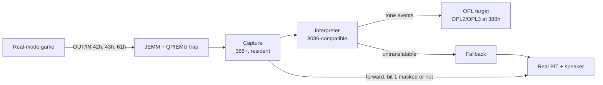

# AGENTS.md

> Orientation for AI agents and human contributors. Read this first; each folder's own
> `AGENTS.md` holds the detail for that folder.

## 1. Overview

ReBeep is a small DOS TSR, written in NASM, that catches what PC-speaker-only games send to the
speaker and plays it on a Sound Blaster's OPL2/OPL3 FM chip instead. It traps ports `42h`, `43h`
and `61h` through JEMM's QPIEMU module, so it needs a 386+ running JEMM.

The repo is also a starter kit. A cross-platform Node CLI, `rebeep`, fetches pinned tools, builds
86Box VMs (MS-DOS 6.22, FreeDOS, a slow 386SX), deploys builds to a delivery disk, and resets
everything to vanilla.

## 2. Repo map

| Folder | What it holds | Guide |
|---|---|---|
| `src/` | ReBeep's NASM source and its build targets | [src/AGENTS.md](src/AGENTS.md) |
| `tests/` | DOS test programs: interpreter tests and the speaker exerciser | [tests/AGENTS.md](tests/AGENTS.md) |
| `env/` | The 86Box environment definition: tool manifest, VM profiles, DOS boot files | [env/AGENTS.md](env/AGENTS.md) |
| `release/` | The package's hand-made files: the manual, `INSTALL.BAT`, `RBPLAY.BAT`, sample configs | [release/AGENTS.md](release/AGENTS.md) |
| `tools/` | The `rebeep` CLI, its libraries and its unit tests | [tools/AGENTS.md](tools/AGENTS.md) |
| `docs/` | Human docs: getting started, the environment guide, contributing | [docs/AGENTS.md](docs/AGENTS.md) |
| `.claude/skills/` | Agent skills: `rebeep-dev` (environment, VMs, build, CLI) and `update-docs` (doc health) | [rebeep-dev](.claude/skills/rebeep-dev/SKILL.md) · [update-docs](.claude/skills/update-docs/SKILL.md) |
| `.github/` | CI workflow and PR template | — |
| `build/` | Build output (ignored) | — |

## 3. Orient fast

```sh
node tools/rebeep.mjs                # list nouns
node tools/rebeep.mjs env status     # tools, media, VMs, baselines, running VMs
node tools/rebeep.mjs <noun> --help  # verbs for a noun
```

The environment lives **outside the repo**, in `~/.rebeep` (override with `REBEEP_HOME` or
`--home`). `npm link` puts `rebeep` on your PATH.

## 4. Commands

| Task | Command |
|---|---|
| Check the host | `rebeep env check` |
| Set up everything that can be | `rebeep env setup` (`npm run setup`) |
| Bring your own MS-DOS / game | `rebeep media add msdos622 <folder>` · `rebeep media add game <zip> --name GPC` |
| Install MS-DOS into a VM | `rebeep vm run mirror-msdos --install` |
| Run a VM | `rebeep vm run <vm>` |
| Build | `rebeep build run` (`npm run build`) |
| Build and put it on every D: | `rebeep build run --deploy` (`npm run deploy`) |
| Release package (zip, floppy, sums, notes in `build/release/`) | `rebeep release create` |
| Version and release (show, check, date `[Unreleased]` and set `package.json`) | `rebeep version show` · `check` · `bump <major\|minor\|patch\|X.Y.Z>` |
| Unit tests | `rebeep test run --suite tools` (`npm test`) |
| Save a VM baseline | `rebeep vm snapshot <vm>` |
| Back to the baseline | `rebeep vm reset <vm>` · `rebeep env reset` |
| Payload guard | `rebeep repo check` (`npm run check`) |

## 5. Architecture



Dev loop: edit `src/` → `rebeep build run --deploy` → boot the VM → run `D:\REBEEP\REBEEP`.

## 6. Hard rules

- **CPU boundary.** `src/engine/` assembles under `CPU 8086`. Only `src/capture/` and
  `src/startup/` may use 386 instructions.
- **NASM versions.** The source must assemble on the pinned NASM 3.02 and on NASM ≥ 2.16.
- **No payloads.** Never commit DOS images, ROMs, emulator binaries, game files, disk images or
  archives. `rebeep repo check` enforces this, and CI runs it.
- **The game is untrusted.** It runs only inside 86Box or on real hardware, never on the host. The
  CLI writes game files from the zip straight into the D: image and never extracts them.
- **D: is disposable.** It is regenerated on every deploy. Names on it are 8.3, uppercase.
- **DOS text files are CRLF.** `.BAT`, `.SYS` and `.TXT` under `env/86box/dos/` and `release/` (see
  `.gitattributes`).
- **Zero npm dependencies.** Tooling is Node ≥ 22 built-ins only.
- **Cross-platform.** Windows, Linux and macOS. Use `path.join`; never hard-code separators or
  shell-specific commands.
- **Pin every download** in `env/86box/manifest.json` with its SHA-256.

## 7. Testing

- `rebeep test run --suite tools` runs the CLI's `node --test` suites in `tools/test/`.
- `rebeep test run --suite interpreter` runs the DOS interpreter tests headless in DOSBox-X.
- `rebeep test run --suite vm` boots `mirror-freedos` for each `tests/vm/P_*.BAT` probe, unattended
  (see [tests/vm/AGENTS.md](tests/vm/AGENTS.md)). It opens 86Box and is not part of `--suite all`.
- Tests build their own fixtures (small zips and images) in a temp folder. No binary fixtures are
  committed.
- In the VMs: `CHKDSK D:` must be clean after a deploy.

## 8. Commits & PRs

- Conventional Commits: `feat`, `fix`, `docs`, `test`, `refactor`, `chore`, `ci`, scoped by area
  (`tools`, `env`, `src`, `tests`, `docs`), for example `feat(tools): add disk list`.
- **Never** write `Co-Authored-By` or any other agent-harness attribution trailer on a commit or PR
  description.
- PRs target `main` and open as drafts. Fill in the PR template.
- Update the affected `AGENTS.md`, skill reference and docs in the same PR as the code.
- Doc rules and the pre-commit `update-docs` run: [section 10](#10-writing-docs).
- Every user-visible change adds a player-facing line under `## [Unreleased]` in
  [CHANGELOG.md](CHANGELOG.md), in the same PR. Write for players: "The hotkey now cycles instrument
  patches", not "refactored the trap handler".

## 9. Security

- Downloads are verified against their pinned SHA-256 before use. Extraction rejects any path that
  escapes the target folder.
- Your own MS-DOS disks and games stay in `~/.rebeep/media/` and are never executed on the host.
- No secrets, tokens or personal paths in the repo.

## 10. Writing docs

Run the `update-docs` skill before every commit or PR; it applies these rules to the change. Each
doc has one job. When two docs need the same fact, one owns it and the others link to it.

| Doc | Job |
|---|---|
| `README.md` | The front door: pitch, what you need, quick start, links out |
| `docs/README.md` | The index: one line per doc |
| `docs/getting-started.md` | Zero to first boot on both paths, plus the Verified-on table |
| `docs/86box-environment.md` | VMs, disks, boot flow, snapshot and reset. Owns troubleshooting |
| `docs/contributing.md` | Workflow, commits, PR rules, payload rules |
| `CHANGELOG.md` | Player-facing changes |
| Folder `AGENTS.md` | That folder's rules and pitfalls |
| CLI help | The source of truth for commands and options (`rebeep <noun> <verb> --help`) |

**Budgets.** Hold altitude and length. Over budget means compress, link out, or, only for a subfolder
with its own invariants, split into a nested `AGENTS.md`. Never raise a budget.

| Doc | Altitude | Budget |
|---|---|---|
| Folder `AGENTS.md` | Intent, invariants, pitfalls, how to run. Never a code walkthrough | ≤ 60 lines |
| Root `AGENTS.md` | Map, commands, hard rules, doc rules | ≤ 200 lines |
| `README.md` | Front door | ≤ 150 lines |
| `docs/*.md` | Tasks and outcomes for people | ≤ 250 lines per page |
| Skill `SKILL.md` · skill reference | Routing and procedure; points to `AGENTS.md` | ≤ 100 · ≤ 60 lines |
| `CHANGELOG.md` | Player language only | Short entries |

**Rules:**

- Every tracked, hand-written top-level folder has an `AGENTS.md`, linked from the map in section 2.
  `.claude/`, `.github/` and `build/` are exempt.
- Every folder `AGENTS.md` uses the template below, in that order.
- Scannable and high signal: tables, short bullets, commands you can copy.
- Write only what the code can't tell you: intent, invariants, pitfalls, how to run.
- Link, don't copy. Commands, options and paths match the code.
- Rewrite in place, and delete lines that stopped being true. Never append "Update:" or dated notes;
  history lives in git and `CHANGELOG.md`.
- No roadmap, status or marketing. No private paths, no references to planning documents, no agent
  attribution.
- A nested `AGENTS.md` is allowed only for a subfolder with its own invariants, and its parent
  links to it.

**Template:**

```markdown
# <folder>

> One-line purpose.

## What's here
| Path | Role |

## Rules
What must stay true.

## Pitfalls
Mistakes that did or will bite.

## Run / test
Folder-specific commands only.

## Related
Links.
```
