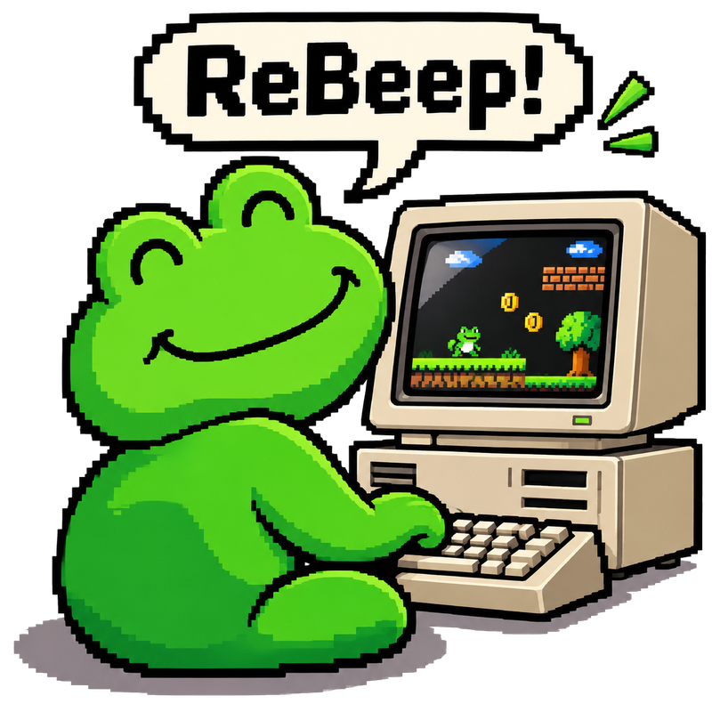

<div align="center">



**Hear your beeper-only DOS games through a real sound card.**

[](https://github.com/MetalHexx/rebeep/actions/workflows/ci.yml)
[](https://github.com/MetalHexx/rebeep/releases/latest)
[](LICENSE)

</div>

---

Plenty of 1980s DOS games can only beep: one square wave, through a tiny speaker inside the case.
Your Sound Blaster sits there silent. ReBeep is a small DOS program that catches those beeps and
plays them on the card's FM chip instead, so the same tunes and effects come out of your speakers.

## Highlights

- **The game's beeps on your sound card.** Melodies, engines and effects play on the OPL2 or OPL3 FM
  chip of a Sound Blaster or a clone, and the PC speaker stays quiet.
- **Nothing goes missing.** Sounds the FM chip can't play, such as noise or very high pitches, still
  go to the real speaker. `/R:0` mutes them instead.
- **Five voices.** A faithful square wave close to the original, or one of four FM patches: Organ,
  Flute, Brass and Bell. Volume runs from 0 to 15.
- **Change it while you play.** Ctrl+Alt+B swaps between the sound card and the speaker, and
  Ctrl+Alt+N cycles the voice. The keys can be changed.
- **Small and tidy.** One `.COM` file under 7 KB that loads high and unloads cleanly. The game is
  never patched.

## How it works

```
game ──OUT 42h/43h/61h──▶ Jemm + QPIEMU ──▶ ReBeep ──▶ OPL2/OPL3 at 388h
                                               └──────▶ PC speaker (fallback)
```

A game beeps by setting a pitch on the PC's timer chip and switching the speaker on. Jemm's QPIEMU
module lets ReBeep catch those port writes as they happen. ReBeep works out the note the game asked
for, plays it on the FM chip, and holds the real speaker still. The details, and what it costs in
speed, are in [how it works](docs/architecture/how-it-works.md).

## What you need

| Need | |
|---|---|
| CPU | A 386 or better |
| DOS | MS-DOS 5 or later, or FreeDOS |
| Memory manager | Jemm 5.87 or later, with its QPIEMU module |
| Sound | An OPL2 or OPL3 FM chip at `388h` (Sound Blaster cards and most clones) |

## Install it

1. Download the zip or the floppy image from the
   [latest release](https://github.com/MetalHexx/rebeep/releases/latest), and copy it to the PC.
2. Run `INSTALL` from the folder that holds `REBEEP.COM`.
3. Run one game with `RBPLAY GAME.EXE`, or load ReBeep at boot from a sample config in the package's
   `SAMPLES` folder.

Options, hotkeys and troubleshooting are in [usage](docs/usage.md).

## Tested on

Grand Prix Circuit, raced on a real Socket 7 PC with a Sound Blaster Vibra 16, and in 86Box on an
emulated Pentium MMX and a 386SX/16, backed by automated checks that run in DOS VMs.
[Compatibility](docs/compatibility.md) lists every result and the known conflicts.

## Documentation

**Playing**

| Doc | What it covers |
|---|---|
| [Usage](docs/usage.md) | Options, hotkeys, voices, exit codes, RBTEST, troubleshooting |
| [How it works](docs/architecture/how-it-works.md) | The design, and the measured cost |
| [Compatibility](docs/compatibility.md) | Tested games and machines, known conflicts |
| [Grand Prix Circuit](docs/gpc.md) | How the game drives the speaker, and what ReBeep makes of it |

**Working on ReBeep**

| Doc | What it covers |
|---|---|
| [Getting started](docs/lab/setup.md) | From a fresh clone to a booted DOS VM, on the Free and Full paths |
| [The 86Box lab](docs/lab/86box-lab.md) | The VMs, their disks, the boot flow, snapshot and reset |
| [Contributing](docs/lab/contributing.md) | Set up, workflow and checks, commits, payload rules |
| [Releasing](docs/lab/releasing.md) | The release procedure and the checks by a person |

## Build it yourself

ReBeep comes with a ready-made 86Box lab: one command-line tool fetches 86Box, FreeDOS and Jemm at
pinned versions, builds the DOS VMs, and puts each new build on them. Start at
[getting started](docs/lab/setup.md).

## Contributing

Issues and pull requests are welcome. Start with [contributing](docs/lab/contributing.md); AI agents
start at [AGENTS.md](AGENTS.md).

## License

[MIT](LICENSE)
