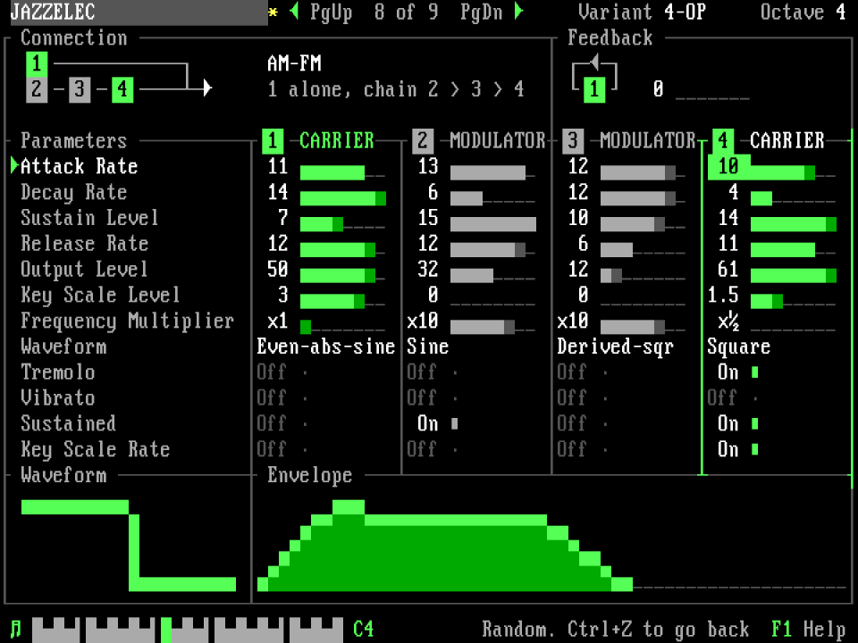
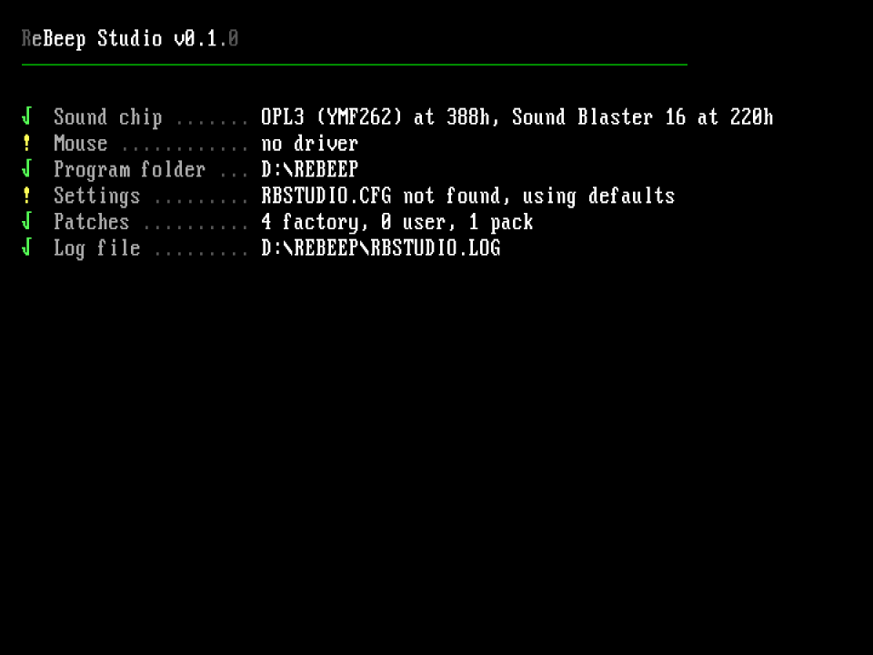
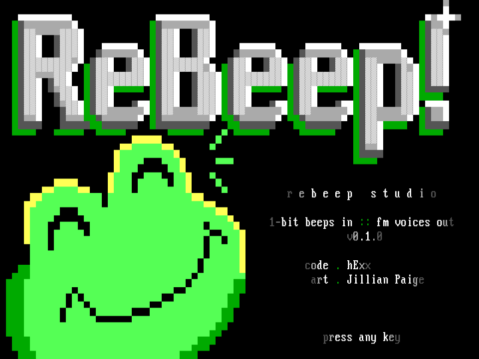
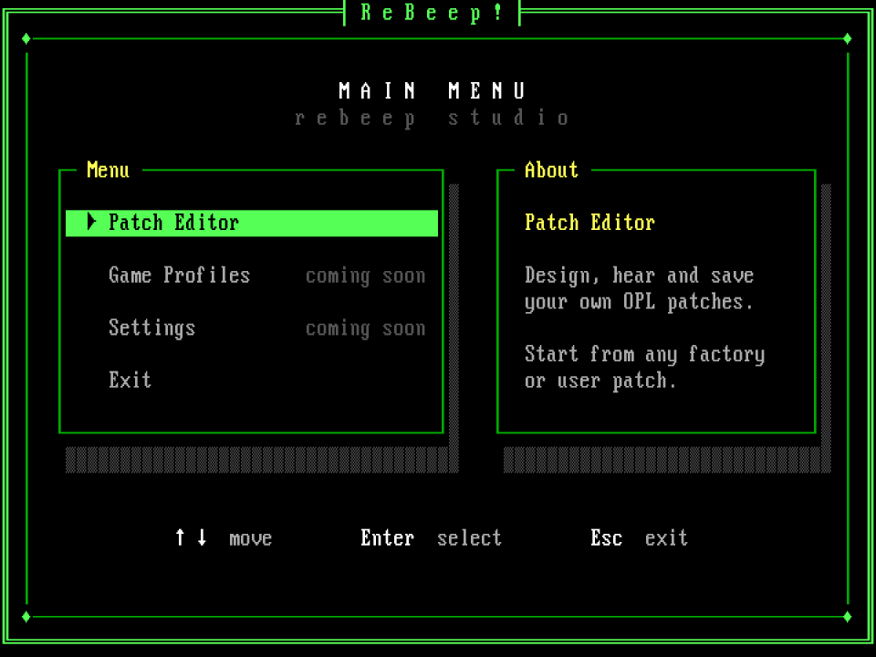
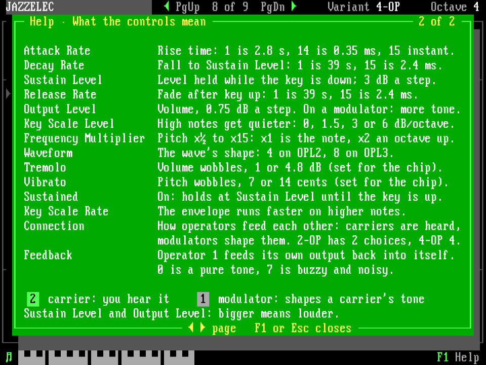
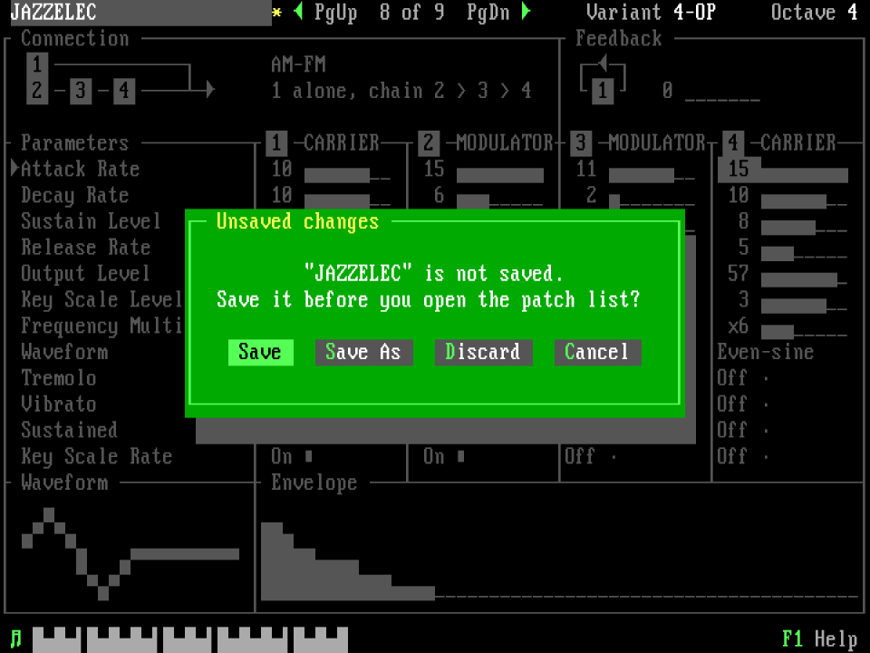

# ReBeep Studio

ReBeep Studio, `RBSTUDIO.EXE`, is a full-screen program for shaping your own FM voices, called
patches, and hearing them as you edit. A patch is a small text file of settings for the sound card's
FM chip. Save one, and ReBeep plays a game's beeps with it. The studio comes in the same package
as ReBeep, and [`INSTALL`](real-pc.md#3-install-rebeep) copies it beside `REBEEP.COM`.

<p align="center"><a href="../images/studio/synth.gif"></a><br>
<sub><b>The synth screen.</b> Each press of F12 rolls a new random sound.</sub></p>

- **Shape two- and four-operator voices**, one operator at a time, with the envelope and the wave
  drawn as you go.
- **Play while you edit.** The keyboard is a piano, and every change is heard at once.
- **Roll the dice.** F12 gives you a random new sound, and F11 nudges the one you have.
- **Keep what you make.** Your patches go in their own folder, the factory patches stay as they
  are, and packs from friends sit beside them.
- **Hear it in your games** with `REBEEP /P:NAME`.

### Every screen

Click a picture to see it full size.

<table>
<tr>
<td align="center"><a href="../images/studio/checks.png"></a><br><b>Checks</b></td>
<td align="center"><a href="../images/studio/splash.png"></a><br><b>Splash</b></td>
<td align="center"><a href="../images/studio/menu.png"></a><br><b>Main menu</b></td>
</tr>
<tr>
<td align="center"><a href="../images/studio/patch-list.png"></a><br><b>Patch list</b></td>
<td align="center"><a href="../images/studio/synth-2op.png"></a><br><b>Synth, 2-OP</b></td>
<td align="center"><a href="../images/studio/synth-4op.png"></a><br><b>Synth, 4-OP</b></td>
</tr>
<tr>
<td align="center"><a href="../images/studio/help-1.png"></a><br><b>Help, page 1</b></td>
<td align="center"><a href="../images/studio/help-2.png"></a><br><b>Help, page 2</b></td>
<td align="center"><a href="../images/studio/save-prompt.png"></a><br><b>Save prompt</b></td>
</tr>
</table>

## What you need

- A sound card with an OPL2 or OPL3 FM chip at port `388h`, as for ReBeep itself. Without one the
  studio opens but stays silent.
- ReBeep need not be loaded. If it is, the studio switches ReBeep off while it runs and back on
  when you quit, so the two never fight over the chip.
- A mouse is optional. Every screen works from the keyboard.

## Start it

```
C:\REBEEP\RBSTUDIO
```

On a monochrome display, add `/VIEW:MONO`. The [reference](reference.md#rbstudio) lists the switches.
The studio finds its files beside itself, wherever you start it from.

## The screens

| Screen | What you do there |
|---|---|
| Checks | The studio looks for the FM chip, a mouse, its folder, its settings file and your patches, and prints each result. A `!` marks something missing that is not a problem, such as no settings file |
| Splash | The title, with a short jingle played on the chip. Press any key |
| Main menu | Move with Up and Down, choose with Enter, leave with Esc. **Patch Editor** is built. **Game Profiles** and **Settings** say `coming soon` |
| Patch list | Every patch the studio can see, grouped by folder. Choose one with Up, Down and Enter, or double-click it. Esc goes back to the menu |
| Synth | The editor: the patch's name, its settings by operator, a drawing of its envelope and wave, and a piano keyboard on the bottom row |

An operator is one of the oscillators that make up an FM voice. A two-operator voice has two, a
modulator that colours the sound and a carrier that you hear. A four-operator voice has four, in two
pairs, and needs an OPL3.

## The keys

F1 shows these on screen, over the synth screen. Esc closes it.

| Keys | Does |
|---|---|
| Up, Down | Move between rows: name, variant, octave, connection, feedback, then the parameters |
| Left, Right | Change the value in focus. Hold the key to keep changing it |
| Alt+1 to Alt+4 | Focus operator 1 to 4 |
| Tab, Shift+Tab | Next, previous operator |
| Z to M | Play notes, the lower row of letters, from C3 |
| Q to P | Play notes, the upper row, from C4. The digit row above holds the sharps |
| Ctrl+Up, Ctrl+Down | Move the piano keys up or down an octave |
| Ctrl+S | Save |
| Ctrl+A | Save As: save under a new name |
| Ctrl+R | Reset to factory: load the factory values and leave the patch unsaved |
| F12 | Random: a new sound for the voice on screen, played on your last piano key while you hold F12 |
| F11 | Mutate: change a few values of the voice on screen a little, played the same way |
| Ctrl+Z, Ctrl+Y | Undo, redo. Holding a key on a bar counts as one undo step |
| PgUp, PgDn | The previous or next patch in the list |
| F1 | Help |
| Esc | Back one level: help or a pop-up first, then the patch list, then the menu |

With a mouse, click a row to focus it, and click a bar to set it.

The note keys use the US layout. When you type a name, the same keys type letters, digits, `-` and
`_`. Enter ends the name and Backspace deletes a character.

## Edit a patch

1. Choose a patch in the list and press Enter. The factory patches are a good start.
2. Play notes on the keyboard while you change values. Every change is heard at once.
3. A star next to the name means unsaved changes. Ctrl+Z undoes them.
4. Press Ctrl+S to save.

**The variant row** switches between the patch's 2-OP and 4-OP voice. A patch can hold both. On an
OPL3 the studio opens a patch on its 4-OP voice when it has one. Choosing 4-OP on a patch that has
none builds one from the 2-OP voice. A four-operator voice does not play on an OPL2.

**Looking for a sound?** F12 gives the voice on screen a random connection, feedback and operators,
and leaves the name, the octave and the other variant as they were. F11 nudges a few values of the
voice you have and keeps its connection, so pressing it again and again drifts the sound. Both play
the last piano key you pressed (C4 until you press one) for as long as you hold the key, and do
nothing while you type a name. Each press is one step for Ctrl+Z, and saving works as for any other
change.

**The octave row** moves the patch up or down from the game's own pitch. The synth screen shows 4
for the game's pitch, and the list shows the shift from it, `0` for none.

**Sustain level and output level** are stored so that a bigger number is louder, whichever way the
chip counts them.

## Patch folders and packs

The studio finds patches in three kinds of folder:

| Folder | Holds | Who writes it |
|---|---|---|
| `FACTORY` | The patches that come with ReBeep: Organ, Flute, Brass and Bell. It sits beside `RBSTUDIO.EXE` | Nobody: `INSTALL` replaces it on every update |
| `USER` | Your own patches | The studio, and you |
| Any other folder | A pack: patches someone gave you, such as `HEXX\` | You. The studio reads a pack but never writes it |

`USER` and the packs live in the **patches folder**, `PATCHES` beside the program. To keep them
elsewhere, see [the settings file](#the-settings-file). A pack is a folder with `.RBP` files in the
patches folder, one level deep. To add one, copy its folder there:

```
XCOPY A:\HEXX C:\REBEEP\PATCHES\HEXX\
```

Names follow DOS rules: up to 8 letters, digits, `-` and `_`, and not only digits. `FACTORY` and
`USER` cannot be pack names. A file that cannot be read is left out of the list, and the reason is
written to the [log](troubleshooting.md#the-studio-log).

## Saving and overrides

The studio writes only to `USER`, and only the patch you are editing. Ctrl+S does the first of these
that fits:

| The patch | Ctrl+S |
|---|---|
| Has a new name | Opens Save As |
| Is in `USER` or `FACTORY` and equals the factory patch of its name | Deletes `USER\NAME`, so the factory patch is back. With no `USER\NAME`, says `Nothing to save` |
| Is in `FACTORY` or a pack, and `USER\NAME` already exists | Refuses, and says `USER\NAME exists: use Save As`. Your file is never overwritten |
| Anything else | Writes `USER\NAME.RBP` |

A `USER` patch with the name of a factory patch is an **override**: ReBeep looks in `USER` before
`FACTORY`, so `REBEEP /P:BELL` plays your Bell. The list marks it `overrides FACTORY\BELL`. To go
back to the factory Bell, open yours, press Ctrl+R, then Ctrl+S, or delete `USER\BELL.RBP`.

Leaving an unsaved patch, with Esc, PgUp or PgDn, opens a prompt with four buttons. Pick one with
the arrow keys and Enter, or press the letter:

| Button | Key | Does |
|---|---|---|
| Save | S | Saves, then goes on |
| Save As | A | Asks for a name, saves, then goes on |
| Discard | D | Goes on without saving |
| Cancel | C | Stays in the editor |

A save writes the new file beside the old one before it replaces it, so a full or read-only disk
leaves your old patch as it was. The studio says so on screen.

## Hear it in a game

1. Save the patch in the studio, for example as `MYLEAD`, and quit.
2. At the DOS prompt, load it. With ReBeep already loaded, name the patch and nothing else changes:

   ```
   REBEEP /P:MYLEAD
   ```

   Without it loaded, `REBEEP /P:MYLEAD` loads ReBeep with the patch. A patch in a pack takes the
   folder too: `REBEEP /P:HEXX\ORGAN`.
3. Start the game. Ctrl+Alt+N switches between the faithful voice and your patch.
4. To use it at every boot, add `PATCH=MYLEAD` to the settings file.

The patch's name is also in `REBEEP /S`. If ReBeep cannot use it, it says why and plays the faithful
voice: see [troubleshooting](troubleshooting.md#a-patch-was-not-used).

## The settings file

`RBSTUDIO.CFG` is a plain text file beside `RBSTUDIO.EXE`. It is optional: `INSTALL` never creates
one and never touches yours. The package has a commented sample, `SAMPLES\RBSTUDIO.CFG`. Copy it
next to the program and remove the `;` in front of a line to use it. ReBeep and the studio both read
it.

| Line | Does |
|---|---|
| `PATCHES=D:\MYSOUNDS` | Where `USER` and the packs are. Plain DOS names only. With no drive or leading `\`, the path starts at the program's folder. The default is `PATCHES` there |
| `PATCH=FLUTE` | The patch ReBeep loads when you give it neither `/F` nor `/P:`. Same names as `/P:` |

A line is `KEY=VALUE`, in any case. A line starting with `;` is a comment, and a line the studio does
not know is ignored. The first line for a key counts. A `PATCHES=` that is not a plain DOS path is
ignored, and the default folder is used. The log says so.

## If something is wrong

The studio writes `RBSTUDIO.LOG` beside itself on every run, and replaces it the next time. The
[troubleshooting](troubleshooting.md#the-studio-log) page says what to look for.
