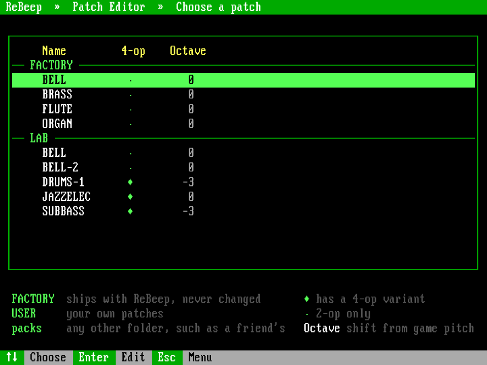
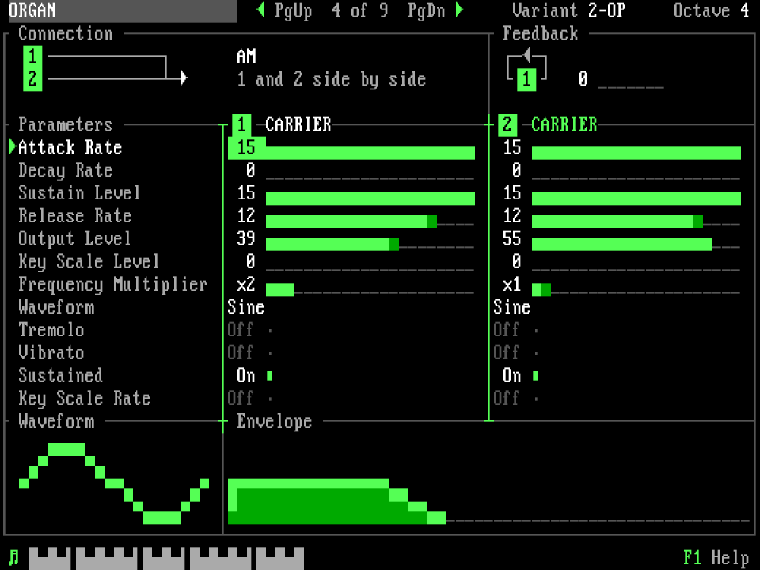
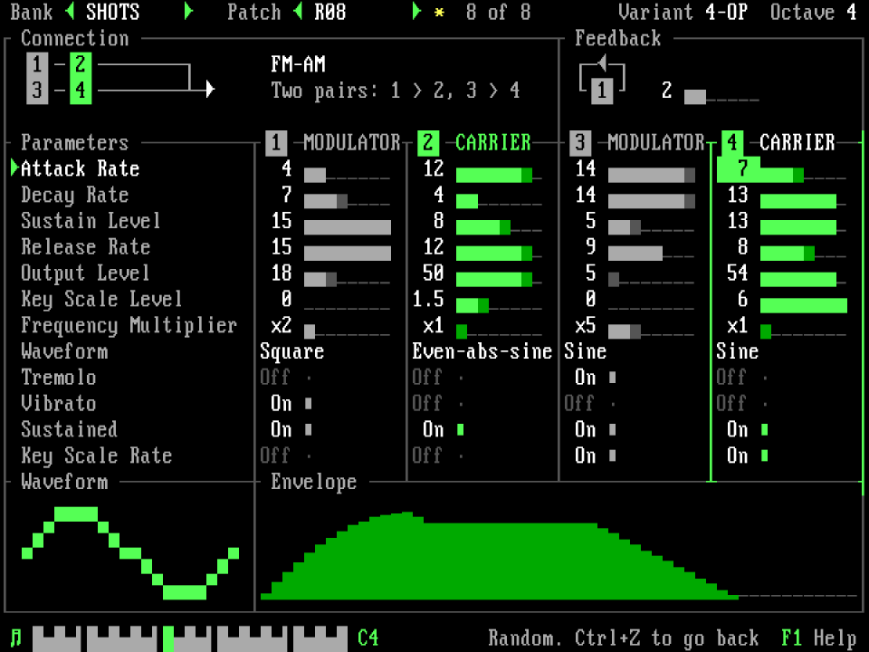
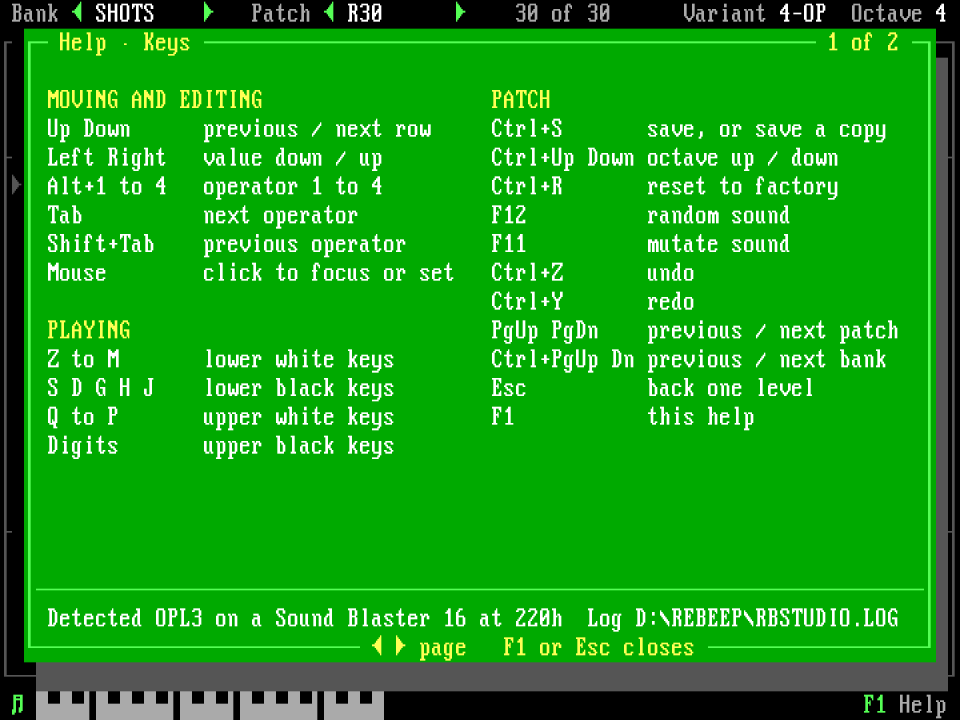
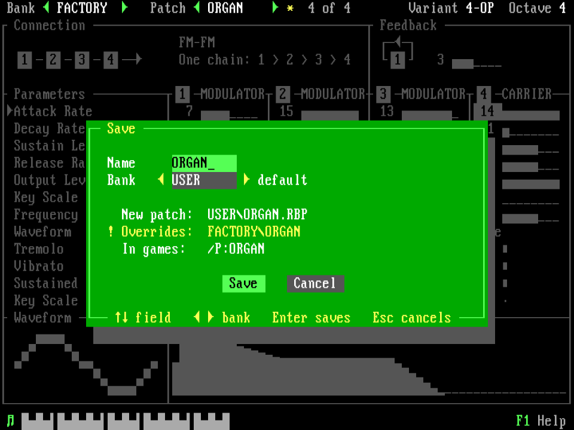

# ReBeep Studio

ReBeep Studio, `RBSTUDIO.EXE`, is a full-screen program for shaping your own FM voices, called
patches, and hearing them as you edit. A patch is a small text file of settings for the sound card's
FM chip. Save one, and ReBeep plays a game's beeps with it. The studio comes in the same package
as ReBeep, and [`INSTALL`](real-pc.md#3-install-rebeep) copies it beside `REBEEP.COM`.

<p align="center"><a href="../images/studio/synth.gif"></a><br>
<sub><b>The synth screen.</b> Each press of F12 rolls a new random sound.</sub></p>

- **Shape two- and four-operator voices**, one operator at a time, with the envelope and the wave
  drawn as you go.
- **Play while you edit.** The keyboard is a piano, and every change is heard at once.
- **Roll the dice.** F12 gives you a random new sound, and F11 nudges the one you have.
- **Keep what you make.** Your patches go in your own bank, a folder of patches, the factory
  patches stay as they are, and banks from friends sit beside them.
- **Hear it in your games** with `REBEEP /P:NAME`.

### Every screen

Click a picture to see it full size.

<table>
<tr>
<td align="center"><a href="../images/studio/checks.png"></a><br><b>Checks</b></td>
<td align="center"><a href="../images/studio/splash.png"></a><br><b>Splash</b></td>
<td align="center"><a href="../images/studio/menu.png"></a><br><b>Main menu</b></td>
</tr>
<tr>
<td align="center"><a href="../images/studio/patch-list.png"></a><br><b>Patch list</b></td>
<td align="center"><a href="../images/studio/synth-2op.png"></a><br><b>Synth, 2-OP</b></td>
<td align="center"><a href="../images/studio/synth-4op.png"></a><br><b>Synth, 4-OP</b></td>
</tr>
<tr>
<td align="center"><a href="../images/studio/help-1.png"></a><br><b>Help, page 1</b></td>
<td align="center"><a href="../images/studio/help-2.png"></a><br><b>Help, page 2</b></td>
<td align="center"><a href="../images/studio/save-prompt.png"></a><br><b>Save prompt</b></td>
</tr>
<tr>
<td align="center" colspan="3"><a href="../images/studio/save-dialog.png"></a><br><b>Save dialog</b></td>
</tr>
</table>

## What you need

- A sound card with an OPL2 or OPL3 FM chip at port `388h`, as for ReBeep itself. Without one the
  studio opens but stays silent.
- ReBeep need not be loaded. If it is, the studio switches ReBeep off while it runs and back on
  when you quit, so the two never fight over the chip.
- A mouse is optional. Every screen works from the keyboard.

## Start it

At the DOS prompt:

```
C:
CD \REBEEP
RBSTUDIO
```

- Add `C:\REBEEP` to your `PATH` ([step 4](real-pc.md#4-add-a-rebeep-boot-menu-entry)) to start it
  from any folder.
- On a monochrome display (an MDA or Hercules card, say) the studio switches to its mono view by
  itself. If yours isn't noticed, start it with `RBSTUDIO /VIEW:MONO`
  ([switches](reference.md#rbstudio)).

## The screens

| Screen | What you do there |
|---|---|
| Checks | The studio looks for the FM chip, a mouse, its folder, its settings file and your patches, and prints each result. A `!` marks something missing that is not a problem, such as no settings file |
| Splash | The title, with a short jingle played on the chip. The studio reads every patch while it shows, with a `Loading patches` percentage, then asks for any key |
| Main menu | Move with Up and Down, choose with Enter, leave with Esc. **Patch Editor** is built. **Game Profiles** and **Settings** say `coming soon` |
| Patch list | Every patch the studio can see, grouped by bank. Choose one with Up, Down and Enter, or double-click it. Left and Right, or the arrows on the top border, switch between all the banks and each one. PgUp, PgDn, Home and End page through a long list. Esc goes back to the menu, and the next visit opens on the view you left |
| Synth | The editor: the bank and patch on the top row, its settings by operator, a drawing of its envelope and wave (smooth on an EGA or VGA card, in coarser steps on others), and a piano keyboard on the bottom row |

An operator is one of the oscillators that make up an FM voice. A two-operator voice has two, a
modulator that colours the sound and a carrier that you hear. A four-operator voice has four, in two
pairs, and needs an OPL3.

## The keys

F1 shows these on screen, over the synth screen. Esc closes it.

| Keys | Does |
|---|---|
| Up, Down | Move between rows: variant, octave, connection, feedback, then the parameters |
| Left, Right | Change the value in focus. Hold the key to keep changing it |
| Alt+1 to Alt+4 | Focus operator 1 to 4 |
| Tab, Shift+Tab | Next, previous operator |
| Z to M | Play the white notes of the lower row, from C3 at Octave 4. S D G H J above them are the sharps |
| Q to P | Play the white notes of the upper row, from C4. The digit row above holds the sharps |
| Ctrl+Up, Ctrl+Down | The patch's octave, up or down. The piano follows it, and so does the patch in a game |
| Ctrl+S | [Save](#saving-and-overrides): save the patch, or a copy of it |
| Ctrl+R | Reset to factory: load the factory values and leave the patch unsaved |
| F12 | Random: a new sound for the voice on screen, played on your last piano key while you hold F12 |
| F11 | Mutate: change a few values of the voice on screen a little, played the same way |
| Ctrl+Z, Ctrl+Y | Undo, redo. Holding a key on a bar counts as one undo step |
| PgUp, PgDn | The previous or next patch in the list, going on into the next bank |
| Ctrl+PgUp, Ctrl+PgDn | The first patch of the previous or next bank |
| F1 | Help |
| Esc | Back one level: help or a pop-up first, then the patch list (an unsaved patch asks first), then the menu |

With a mouse, click a row to focus it, and click a bar to set it.

The note keys use the US layout. In the Save dialog the same keys type a name: letters, digits, `-`
and `_`, with Backspace to delete.

## Edit a patch

1. Choose a patch in the list and press Enter. The factory patches are a good start.
2. Play notes on the keyboard while you change values. Every change is heard at once.
3. A star next to the patch's name means unsaved changes. Ctrl+Z undoes them, and the star goes when
   undo or redo gets back to the patch as you opened or last saved it.
4. Press Ctrl+S to [save](#saving-and-overrides).

**The top row** shows where the patch is. **Bank** and **Patch** name its bank and the patch, with its
place in the bank (`2 of 4`). Click their arrows, or press PgUp and PgDn for the previous or next
patch and Ctrl+PgUp and Ctrl+PgDn for the previous or next bank. Leaving a patch with unsaved changes
asks first.

**The variant row** switches between the patch's 2-OP and 4-OP voice. A patch can hold both. On an
OPL3 the studio opens a patch on its 4-OP voice when it has one. Choosing 4-OP on a patch that has
none builds one from the 2-OP voice. A four-operator voice does not play on an OPL2.

**Looking for a sound?** F12 gives the voice on screen a random connection, feedback and operators,
and leaves the name, the octave and the other variant as they were. F11 nudges a few values of the
voice you have and keeps its connection, so pressing it again and again drifts the sound. Both play
the last piano key you pressed (C4 until you press one) for as long as you hold the key, and do
nothing while you type a name. Each press is one step for Ctrl+Z, and saving works as for any other
change.

**The octave** is one setting: the patch's own pitch, saved with it. The top row shows 4 for the game's
pitch, and the piano plays around it, so there is no second octave to keep track of. Change it with
the octave row or Ctrl+Up and Ctrl+Down. The list shows the shift from the game's pitch, `0` for none.

**Sustain level and output level** are stored so that a bigger number is louder, whichever way the
chip counts them.

## Banks

A **bank** is a folder of patches, and the studio finds banks in three places:

| Bank | Holds | Who writes it |
|---|---|---|
| `FACTORY` | The patches that come with ReBeep: Organ, Flute, Brass and Bell. It sits beside `RBSTUDIO.EXE` | Nobody: `INSTALL` replaces it on every update |
| `USER` | Your own patches, and the default place to save | The studio, and you |
| Any other folder | Patches someone gave you, such as `HEXX\`, or a bank you made | You, and the studio when you save into it |

`USER` and the other banks live in the **patches folder**, `PATCHES` beside the program. To keep them
elsewhere, see [the settings file](#the-settings-file). A bank is a folder with `.RBP` files in the
patches folder, one level deep, and it shows up once it holds a patch. To add one, copy its folder
there:

```
XCOPY A:\HEXX C:\REBEEP\PATCHES\HEXX\
```

The studio reads up to 2,048 patches, in at most 64 banks besides `FACTORY` and `USER`, and logs
any it leaves out. It reads ReBeep's own `.RBP` files only: AdLib `.BNK` banks are not read. Names
follow DOS rules: up to 8 letters, digits, `-` and `_`, and not only digits. `FACTORY` and `USER`
cannot be new bank names. A file that cannot be read is left out of the list, and the reason is
written to the [log](troubleshooting.md#the-studio-log).

## Saving and overrides

Ctrl+S opens the **Save dialog** over the synth screen. It saves the patch, or a copy of it, into a
bank. The studio never writes to `FACTORY`.

| Field | What you set |
|---|---|
| Name | The patch's name. It starts as the patch's own |
| Bank | `USER` (the default), a bank you have, or a new one. Left and Right choose; on a new bank, type its name and the studio makes the folder |

Up and Down change field. Enter, or the Save button, saves. Esc, or Cancel, closes the dialog and
saves nothing. The lines under the fields say what Enter will do before you press it:

| Line | Means |
|---|---|
| `New patch:` | A new file. `New bank:` comes first when the bank is new |
| `Updates:` | The patch you opened, in its own bank |
| `Replaces:` | Another file of that name in the bank: Enter overwrites it. A `!` marks the line |
| `Overrides:` | The name is a factory patch's: see below. A `!` marks a new override |
| `Matches:`, `Removes:` | The patch equals the factory one of its name, so saving it in `USER` removes your file and brings the factory patch back |
| `Nothing to save` | As above, with no file of yours to remove |
| `In games:` | What to type to hear it: `/P:NAME`, or `/P:BANK\NAME` outside `USER` |

A refused name or bank, or a full list, shows a `!` line instead, and Enter does nothing until you
fix it. The studio refuses a bad name, a new bank named like one you have, and a new patch when the
list already holds 2,048.

A `USER` patch with the name of a factory patch is an **override**: ReBeep looks in `USER` before
`FACTORY`, so `REBEEP /P:BELL` plays your Bell. To go back to the factory Bell, open yours and press
Ctrl+R to load the factory values, which leaves the patch unsaved. Then press Ctrl+S: the dialog says
`Removes:`, and Enter deletes your file. You can also delete `USER\BELL.RBP` yourself.

Leaving an unsaved patch, with Esc, PgUp, PgDn, Ctrl+PgUp or Ctrl+PgDn, opens a prompt with three
buttons. Pick one with the arrow keys and Enter, or press the letter:

| Button | Key | Does |
|---|---|---|
| Save | S | Opens the Save dialog, and goes on once it has saved |
| Discard | D | Goes on without saving |
| Cancel | C | Stays in the editor. Esc does the same |

A save writes the new file beside the old one before it replaces it, so a full or read-only disk
leaves your old patch as it was. The studio says so on screen.

## Hear it in a game

1. Save the patch in the studio, for example as `MYLEAD`, and quit.
2. At the DOS prompt, load it. With ReBeep already loaded, name the patch and nothing else changes:

   ```
   REBEEP /P:MYLEAD
   ```

   Without it loaded, `REBEEP /P:MYLEAD` loads ReBeep with the patch. A patch in another bank takes
   the bank too: `REBEEP /P:HEXX\ORGAN`.
3. Start the game. Ctrl+Alt+N switches between the faithful voice and your patch.
4. To use it at every boot, add `PATCH=MYLEAD` to the settings file.

The patch's name is also in `REBEEP /S`. If ReBeep cannot use it, it says why and plays the faithful
voice: see [troubleshooting](troubleshooting.md#a-patch-was-not-used).

## The settings file

`RBSTUDIO.CFG` is a plain text file beside `RBSTUDIO.EXE`. It is optional: `INSTALL` never creates
one and never touches yours. The package has a commented sample, `SAMPLES\RBSTUDIO.CFG`. Copy it
next to the program and remove the `;` in front of a line to use it. ReBeep and the studio both read
it.

| Line | Does |
|---|---|
| `PATCHES=D:\MYSOUNDS` | Where `USER` and the other banks are. Plain DOS names only. With no drive or leading `\`, the path starts at the program's folder. The default is `PATCHES` there |
| `PATCH=FLUTE` | The patch ReBeep loads when you give it neither `/F` nor `/P:`. Same names as `/P:` |
| `PROFILES=D:\MYGAMES` | Where the [game profiles](playing.md#game-profiles) are, a folder each. The same kind of path as `PATCHES=`. The default is `PROFILES` beside the program |

A line is `KEY=VALUE`, in any case. A line starting with `;` is a comment, and a line the studio does
not know is ignored. The first line for a key counts. A `PATCHES=` that is not a plain DOS path is
ignored, and the default folder is used. The log says so.

## If something is wrong

The studio writes `RBSTUDIO.LOG` beside itself on every run, and replaces it the next time. The
[troubleshooting](troubleshooting.md#the-studio-log) page says what to look for.
